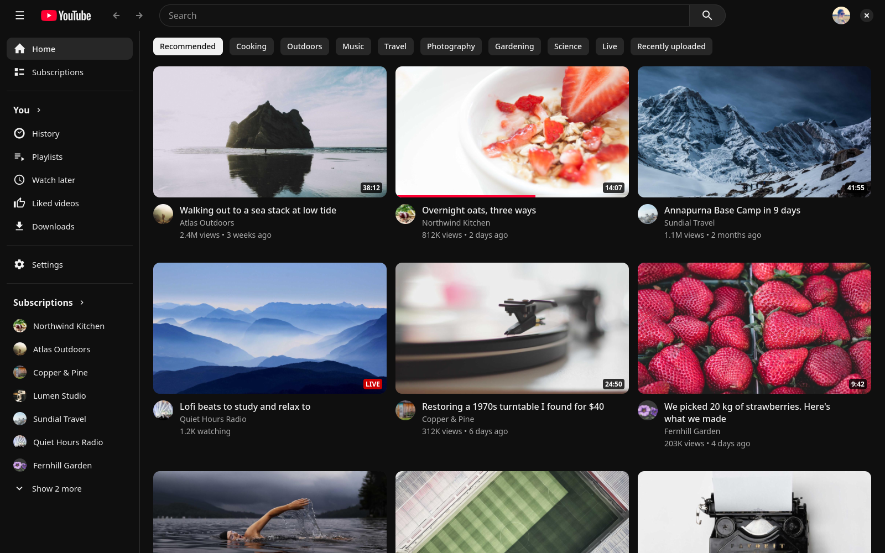

<p align="center">
  <picture>
    <source media="(prefers-color-scheme: dark)" srcset="assets/logo-dark.svg">
    
  </picture>
</p>

yt-rs is a YouTube app for the desktop, written in Rust. The interface is
GTK 4 and libadwaita, videos play in mpv, and plugins are written in Lua.
I wanted a YouTube that opens instantly, looks like youtube.com, doesn't eat
a gigabyte of memory, and that I can change without forking it.

It signs in the way a smart TV does and talks to YouTube as the YouTube TV
app. Your Home feed, subscriptions, history and recommendations are your
own, and what you watch shows up in your history with the place you stopped.
Without signing in, everything that doesn't need an account still works.

<p align="center">
  
</p>

## What's in it

- Home, Subscriptions, History, Watch later, Liked videos and your
  playlists, with the same video menus youtube.com has ("Not interested",
  "Don't recommend channel", Save, Add to queue).
- Search with suggestions as you type, your earlier searches, the chips and
  the filters, channel and playlist results, and spelling corrections.
- Playback in mpv with hardware decoding. Videos start in well under a
  second, resume where you left off, and play in 1080p by default (up to 4K
  from the quality menu).
- Captions, playback speed, stable volume, a sleep timer, loop, chapters
  and preview frames on the seek bar, theater mode, fullscreen, autoplay
  and ambient mode.
- A mini player that keeps the video going while you look around.
- Live streams with their chat (Top chat or every message, Super Chats,
  memberships, pinned messages, channel emoji). You can rewind a stream as
  far back as YouTube keeps it, often 12 hours.
- Comments: sort them, read replies, like them, write comments and replies,
  and delete your own.
- Channel pages with their Home, Videos, Shorts, Live and Playlists tabs,
  subscribing, and all your subscriptions on one page.
- Downloads, to watch videos offline.
- Media keys and the desktop's media controls on Linux (MPRIS).
- SponsorBlock, to skip sponsors and the other parts people marked, with
  the extension's segments on the seek bar, votes and submissions.
- YouTube's notification bell, on Linux. It needs its own sign-in, once,
  with the same Google account.
- No ads. A video with a pre-roll ad starts a few seconds late instead,
  because YouTube doesn't send the stream until the ad could have been
  skipped.

## Installing

The [releases page](https://github.com/shinyvision/yt-rs/releases) has
builds for Linux, macOS and Windows, for x86_64 and arm64.

On Linux you need GTK 4.18 or newer, libadwaita 1.7 or newer, libmpv and
LuaJIT, plus a Secret Service keyring such as GNOME Keyring or KeePassXC for
the sign-in. The release build is made on Fedora 42 and runs on anything at
least as new: Debian 13, Ubuntu 25.10, Fedora 42, Arch and so on. Ubuntu
24.04's GTK is too old.

Debian and Ubuntu keep the data plugins use to reach GTK and libadwaita in
separate `gir1.2` packages:

```sh
sudo apt install libgtk-4-1 libadwaita-1-0 libmpv2 libluajit-5.1-2 libgirepository-2.0-0 gir1.2-adw-1
```

Fedora:

```sh
sudo dnf install gtk4 libadwaita mpv-libs luajit
```

Arch Linux:

```sh
sudo pacman -S gtk4 libadwaita mpv luajit
```

The notification bell also needs WebKitGTK 6.0 (for its sign-in), libsoup 3
and libsecret. Without them there's no bell, and everything else works.
They're `gir1.2-webkit-6.0 gir1.2-soup-3.0 gir1.2-secret-1` on Debian and
Ubuntu, `webkitgtk6.0 libsoup3 libsecret` on Fedora, and
`webkitgtk-6.0 libsoup3 libsecret` on Arch.

On macOS, install the libraries with Homebrew and run `yt-rs` from the
archive. The sign-in is kept in the macOS keychain.

```sh
brew install gtk4 libadwaita mpv luajit gobject-introspection
```

On Windows, unzip the archive and run `bin\yt-rs.exe`. Everything it needs
is in the zip, and the sign-in is kept in the Windows Credential Manager.

Linux is what I use every day. The macOS and Windows builds compile and
package fine, but they haven't seen much use yet, so expect rough edges
there and please open an issue when you hit one.

## Building it yourself

You need Rust 1.90 or newer, a C compiler, pkg-config, and the development
files for GTK 4, libadwaita, libmpv, LuaJIT and GLib (2.80 or newer, for
libgirepository-2.0).

```sh
cargo build --release
./target/release/yt-rs
```

## Signing in

The first time you start it, the app shows a short code. Enter it at
google.com/device and pick your account or channel, the same as setting up
YouTube on a TV. Your Google account will list the app as "YouTube on TV".

The sign-in is stored in the system keyring and nowhere else. Signing out
removes it and revokes the session with Google.

## Keys

| Key | Where | What it does |
|---|---|---|
| Space, K | video | play or pause |
| ← → | video | back or forward 5 seconds |
| J L | video | back or forward 10 seconds |
| ↑ ↓ | video | volume |
| M | video | mute |
| C | video | captions on or off |
| < > | video | slower or faster |
| 0 to 9, Home, End | video | jump to 0% to 90%, the start, the end (or a live stream's edge) |
| , . | video | a frame back or forward, while paused |
| T | video | theater mode |
| Shift+N | video | next video |
| F, F11 | video, anywhere | fullscreen |
| / | anywhere | search |
| Esc | anywhere | go back, or leave fullscreen |
| Alt+← Alt+→, mouse side buttons | anywhere | back and forward through the pages you visited |
| Ctrl+R, F5 | anywhere | refresh |
| Ctrl+Q | anywhere | quit |
| ? | anywhere | list every shortcut |

Clicking the video pauses it and double-clicking toggles fullscreen.
Plugins can change any of these.

## Plugins

A plugin is a Lua file at `plugins/<name>/init.lua` in the app's config
folder (`~/.config/yt-rs` on Linux; Settings shows where it is). Plugins
are trusted code, like Neovim plugins, and they can get at everything the
app itself uses:

- every function of the app's services, to call or to hook: YouTube's API,
  which streams play, the player, playback, search, settings and so on
  (`app.api` and `app.hook`)
- any library with GObject introspection data, GTK and libadwaita
  included, and new widget types of their own (`gi`)
- every part of the interface, every command and key binding, and the
  styles

[docs/plugins.md](docs/plugins.md) explains how, and
[docs/api.md](docs/api.md) lists every function. There are examples in
[examples/plugins](examples/plugins):

| Example | What it shows |
|---|---|
| [quality](examples/plugins/quality/init.lua) | capping videos at 720p with a hook on the stream resolver |
| [feed-filter](examples/plugins/feed-filter/init.lua) | hiding videos, a badge on every card, extra menu items |
| [shortcuts](examples/plugins/shortcuts/init.lua) | key bindings, new commands, mpv properties |
| [theme](examples/plugins/theme/init.lua) | restyling with CSS and changing built-in widgets |
| [browser](examples/plugins/browser/init.lua) | a WebKit browser page |
| [terminal](examples/plugins/terminal/init.lua) | a terminal page, with VTE |
| [snake](examples/plugins/snake/init.lua) | a game, drawn with Cairo |

To try one, link it into your plugins folder:

```sh
ln -s "$PWD/examples/plugins/snake" ~/.config/yt-rs/plugins/
```

Two plugins come with the app and are on until you switch them off in
Settings: [sponsorblock](plugins/sponsorblock/init.lua), the whole
SponsorBlock extension (skipping, the seek bar, votes, marking and
submitting segments), and [notifications](plugins/notifications), YouTube's
notification bell. A plugin with the same name in your plugins folder
takes the place of the one that comes with the app.

## Environment variables

| Variable | Default | |
|---|---|---|
| `YT_RS_CONFIG_DIR` | `~/.config/yt-rs` | settings and plugins; another folder is a separate profile with its own sign-in |
| `YT_RS_CACHE_DIR` | `~/.cache/yt-rs` | thumbnails |
| `YT_RS_DATA_DIR` | `~/.local/share/yt-rs` | downloads |
| `YT_RS_APP_ID` | `dev.ytrs.YtRs` | the app ID, which is also the window class, for telling instances apart in window manager rules |
| `YT_RS_LOG` | `warn,yt_app=info,yt_core=info` | what gets logged, in `tracing`'s filter syntax |
| `YT_RS_MPV_LOG` | `warn` | how much of mpv's log to pass on (`v`, `debug`, `trace`) |
| `YT_RS_DRY_RUN` | unset | set to `1` and nothing that changes your account is sent (likes, subscriptions, playlists, comments); the app behaves as if it was |
| `GSK_RENDERER` | `gl` | GTK's renderer |

The defaults are the Linux ones. On macOS and Windows the folders are the
usual ones for those systems.

## Performance

On my laptop (Intel and NVIDIA, Linux, Hyprland), with the release build:

| | |
|---|---|
| window on screen | 0.5 s after launch |
| Home feed on screen | 1.5 to 1.7 s after launch |
| click to playing, card hovered first | 0.65 s |
| click to playing, cold | 0.3 to 1.1 s (a live stream about 4 s) |
| CPU while playing 1080p VP9 | 4 to 5% of one core |
| memory while browsing | 93 MB of its own (217 MB PSS) |
| memory while playing 1080p | 146 MB of its own |

The resident size looks bigger than that because it counts the GPU driver,
which every program using the GPU shares.

## How it works

The app talks to InnerTube, YouTube's internal API, as the YouTube TV app,
because YouTube only accepts the TV sign-in from TV clients. Video streams
come from the same request the TV app makes, so there's no "confirm you're
not a bot" check. The scrambled parts of stream URLs are solved by
yt-dlp's challenge solver, which is bundled and runs in an embedded
JavaScript engine. Live streams are read a segment at a time.

The interface is put together from registries of components, commands,
keys, events and styles, and the built-in parts use them the same way
plugins do. [docs/architecture.md](docs/architecture.md) goes into more
detail.

## Known limitations

- Using an unofficial client is against YouTube's terms of service. The app
  makes about as many requests as the TV app does.
- The TV app's client ID and version numbers are built in. If YouTube
  retires them, signing in or reporting watch time stops working until the
  app is updated.
- When YouTube changes its player in a way the bundled challenge solver
  doesn't understand, videos stop playing until the solver is updated. You
  can drop a newer solver into the config folder's `solver` folder (see
  [crates/yt-core/src/solver/README.md](crates/yt-core/src/solver/README.md)).
- Comments can't be edited and creators' hearts on comments don't show,
  because the TV API has neither.
- Writing in a live chat opens youtube.com, since the TV app can't post to
  chats.

## License

MIT, see [LICENSE](LICENSE). The SponsorBlock plugin, which the builds
include, uses the SponsorBlock extension's own icons, which are GPL-3.0
(see [their notice](plugins/sponsorblock/icons/NOTICE)). The notifications
plugin includes the Roboto font under the SIL Open Font License.

yt-rs isn't affiliated with YouTube or Google.
